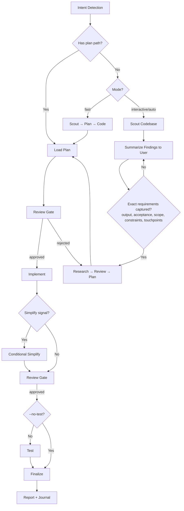

# Cook - Smart Feature Implementation

End-to-end implementation with automatic workflow detection.

**Principles:** YAGNI, KISS, DRY | Token efficiency | Concise reports

## Usage

```
/cook <natural language task OR plan path>
```

If no flag is provided, the skill will use the `interactive` mode by default for the workflow.

**Optional flags to select the workflow mode:** 
- `--interactive`: Full workflow with user input (**default**)
- `--fast`: Skip research, scout→plan→code
- `--parallel`: Multi-agent execution
- `--no-test`: Skip testing step
- `--auto`: Auto-approve low-risk steps; high-risk changes stop for human approval before finalize/commit/ship

**Composable flags** (combine with any mode):
- `--tdd`: Tests-first per phase — write tests for current behavior before
  refactoring, then verify they still pass after the implementation step

**Example:**
```
/cook "Add user authentication to the app" --fast
/cook path/to/plan.md --auto
/cook "Refactor auth middleware" --tdd
```

## Size the Task First

Pick the lightest workflow that still verifies the change, because every subagent reloads project context and multiplies token cost.

| Size | Signals | Workflow |
|------|---------|----------|
| Small | 1-3 files, no public contract, schema or dependency change | Scout inline, state a 3-6 bullet plan in the reply, implement, run the relevant tests yourself, review your own diff. No plan files, no subagents. |
| Medium | Several files or modules, or a contract change with known callers | Plan files via `/adf-plan`, `tester` and `code-reviewer` subagents. |
| Large / high-risk | Cross-module, migrations, auth/security, public API, `--parallel` | Full workflow below with every review gate. |

State the chosen size and why in Step 0. If the user overrides ("just code it", "full workflow"), follow them.

<HARD-GATE>
Medium and large tasks: do not write implementation code until the plan files exist and the user has approved them (or `--auto` artifact gates pass). Small tasks: state the bullet plan, then implement in the same turn unless the user asked to review the plan first or the scout turns up a contract, schema or dependency change (then re-size the task).
User override: if the user explicitly says "just code it" or "skip planning", respect it.
</HARD-GATE>

<HARD-GATE-SCOUT-FIRST>
Before planning OR asking clarifying questions, scan the codebase. Mandatory scout outputs:
1. Project type, language(s), framework(s)
2. Existing modules/files relevant to the task
3. Current patterns/conventions for similar features (so the implementation matches them)
4. Existing docs in `./docs/` and any in-flight plans in `./plans/` covering this area
5. Public APIs, schemas, contracts that the task could affect

State a 3-6 bullet codebase-context summary to the user before asking questions. Skip only when input is a `plan.md`/`phase-*.md` path (the plan already encodes scout output).
</HARD-GATE-SCOUT-FIRST>

<HARD-GATE-EXACT-REQUIREMENTS>
Before producing a plan, be able to answer each of these in one concrete sentence. Use `AskUserQuestion` only for the ones the request and scout leave open; do not proceed on vague intent:

1. **Expected output**: the concrete artifact(s) the user will see at the end (file paths, feature behavior, UI screen, API endpoint + payload, CLI command + flags).
2. **Acceptance criteria**: specific behaviors / inputs → outputs / edge cases that must work to call it "done".
3. **Scope boundary**: what is explicitly OUT of scope this round.
4. **Non-negotiable constraints**: stack, file locations, naming, backward compatibility, deadlines, performance.
5. **Touchpoints**: which existing files/modules (from scout) will be modified or extended; which contracts must stay stable.

Ground every `AskUserQuestion` option in scout findings (e.g., "Add to `src/api/users.ts` (matches existing pattern) or new `src/api/profile.ts`?"). Skip only when input is a `plan.md`/`phase-*.md` path.
</HARD-GATE-EXACT-REQUIREMENTS>

<HARD-GATE-NO-SIDE-EFFECTS>
Implementation is not done until verified to be side-effect-free. Code-review and test gates must show:

1. New behavior matches every acceptance criterion above.
2. All tests pass — including tests in modules that share files/contracts with the change.
3. No existing business logic / workflow regression: explicitly walk each touchpoint and any caller of changed functions.
4. No new lint/type/build errors anywhere in the repo.
5. Public contracts unchanged unless intentional and called out (function signatures, exported types, API responses, DB schemas, env vars, config keys).

User override: If user invoked `--no-test`, item 2 is downgraded to a warning. Surface the unverified-tests risk in the finalize `AskUserQuestion` so the user accepts the trade-off rather than having it silently chosen. Items 1, 3, 4, 5 remain enforced by the code review step.

If review/testing reveals a side effect, regression, or broken workflow, stop. Use `AskUserQuestion` to present:
- What broke (file, test, workflow, user-facing behavior)
- Why this implementation caused it (1-line cause)
- 2-4 concrete options for the user to choose, e.g.:
  - "Revert this slice and re-plan with stricter scope"
  - "Keep the implementation and update <dependents> to match the new contract"
  - "Add a compatibility shim at <boundary> so old callers keep working"
  - "Accept the regression — old behavior was unintended/buggy"

Let the user decide. Do not silently patch around regressions.
</HARD-GATE-NO-SIDE-EFFECTS>

## Smart Intent Detection

| Input Pattern | Detected Mode | Behavior |
|---------------|---------------|----------|
| Path to `plan.md` or `phase-*.md` | code | Execute existing plan |
| Contains "fast", "quick" | fast | Skip research, scout→plan→code |
| Contains "trust me", "auto" | auto | Auto-approve low-risk artifact-validated steps; stop on high-risk |
| Lists 3+ features OR "parallel" | parallel | Multi-agent execution |
| Contains "no test", "skip test" | no-test | Skip testing step |
| Default | interactive | Full workflow with user input |

See `references/intent-detection.md` for detection logic.

For cross-skill workflow sequence decisions, load
`references/workflow-routing.md` before selecting the owning skill.

## Process Flow (Authoritative)



**This diagram is the authoritative workflow.** Prose sections below provide detail for each node. If prose conflicts with this flow, follow the diagram.

## Workflow Overview

```
[Intent Detection] → [Research?] → [Review] → [Plan] → [Review] → [Implement] → [Conditional Simplify?] → [Review] → [Test?] → [Review] → [Finalize]
```

**Default (non-auto):** Stops at `[Review]` gates for human approval before each major step.
**Auto mode (`--auto`):** Skips human review gates only for low-risk work. High-risk changes stop for human approval before finalize/commit/ship.
**Claude Tasks:** Track implementation with `TaskCreate`, `TaskUpdate`, `TaskGet`, `TaskList` for medium and large tasks.

| Mode | Research | Testing | Review Gates | Phase Progression |
|------|----------|---------|--------------|-------------------|
| interactive | ✓ | ✓ | **User approval at each step** | One at a time |
| auto | ✓ | ✓ | Auto only if artifacts pass and high-risk stop is false | All low-risk phases continuously |
| fast | ✗ | ✓ | **User approval at each step** | One at a time |
| parallel | Optional | ✓ | **User approval at each step** | Parallel groups |
| no-test | ✓ | ✗ | **User approval at each step** | One at a time |
| code | ✗ | ✓ | **User approval at each step** | Per plan |

## Step Output Format

```
✓ Step [N]: [Brief status] - [Key metrics]
```

## Blocking Gates (Non-Auto Mode)

Human review required at these checkpoints (skipped with `--auto`):
- **Post-Research:** Review findings before planning
- **Post-Plan:** Approve plan before implementation
- **Post-Implementation:** Approve code before testing
- **Post-Testing:** 100% pass + approve before finalize

**Always enforced (all modes):**
- **Testing:** 100% pass required (unless no-test mode). Report done only after actually running the tests, type-check or build; never claim a check you did not run.
- **Code Review:** small tasks review their own diff against the checks below. Medium and large tasks spawn the `code-reviewer` subagent with explicit checks:
  (a) every acceptance criterion met,
  (b) no regression to business logic in touchpoints/blast-radius,
  (c) no breaking changes to public contracts (signatures, schemas, APIs, env vars) unless called out,
  (d) follows existing patterns from scout,
  (e) no new lint/type/build errors anywhere.
  Pass scout summary + acceptance criteria as context. If reviewer flags side effects → trigger HARD-GATE-NO-SIDE-EFFECTS (`AskUserQuestion` with 2-4 options).
  Then: User approval OR artifact-gated auto approval. Score is advisory; it never approves by itself.
- **Implement:** at the start, read `docs/conventions/code-standards.md` when it exists.
- **Finalize:** each step runs only when its condition holds.
  1. Plan files exist → activate `/project-management` to sync every `phase-XX-*.md` and `plan.md` status/progress
  2. User-visible behavior, setup, commands or architecture changed → `docs-manager` subagent updates `./docs`
  3. Claude Tasks were created → `TaskUpdate` marks them complete
  4. Ask the user whether to commit. Spawn `git-manager` only after they say yes; never commit unasked.
  5. Run `/journal` only when the user asks or the work hit a notable setback worth recording

## Subagents by Task Size

| Phase | Subagent | Small | Medium | Large / high-risk |
|-------|----------|-------|--------|-------------------|
| Research | `researcher` | — | Optional | Yes (fast/code: skip) |
| Plan | `planner` | — | Optional | Yes |
| UI Work | `ui-ux-designer` | — | If frontend | If frontend |
| Testing | `tester`, `debugger` on failure | Run tests yourself | Yes | Yes |
| Review | `code-reviewer` | Self-review diff | Yes | Yes |
| Finalize | `docs-manager`, `git-manager` | Per finalize conditions | Per finalize conditions | Per finalize conditions |

Spawn pattern: `Agent(subagent_type="[type]", prompt="[task + files + acceptance criteria]", description="[brief]")`. Give each subagent the scout summary and acceptance criteria rather than the whole conversation. When the plan has `scope`, list those paths as the files a subagent may modify.

## References

- `references/intent-detection.md` - Detection rules and routing logic
- `references/workflow-routing.md` - Cross-skill sequence routing
- `references/workflow-steps.md` - Detailed step definitions for all modes
- `references/review-cycle.md` - Interactive and auto review processes
- `references/subagent-patterns.md` - Subagent invocation patterns
- `../_shared/references/workflow-artifacts.md` - Review artifact schema and validator contract

## Workflow Position

**Typically follows:** `/adf-plan` (execute a plan), `/brainstorm-technical` or `/brainstorm-features` (implement agreed solution)
**Typically precedes:** `/adf-code-review` (review after implementation), `/test` (validate changes)
**Related:** `/fix` (alternative for bug fixes), `/adf-plan` (create plan before cooking)
