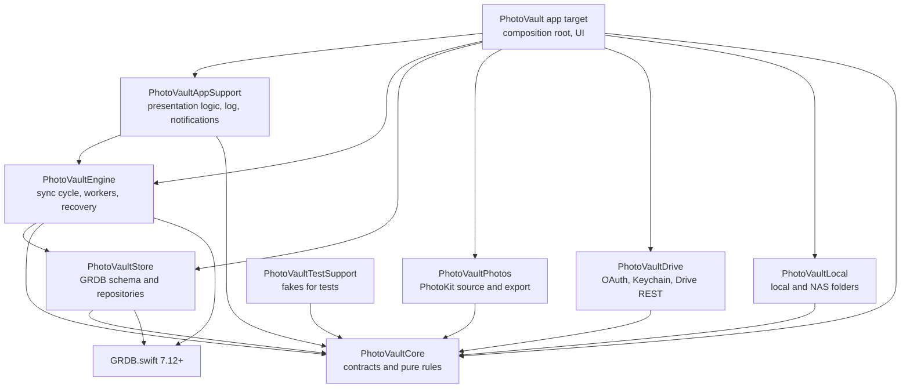
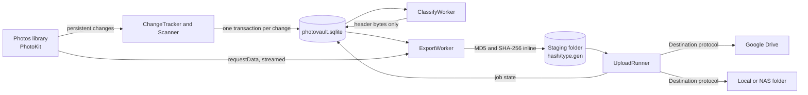
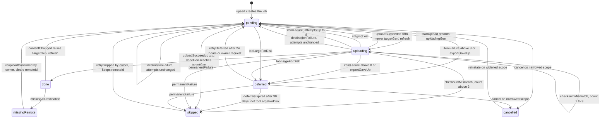
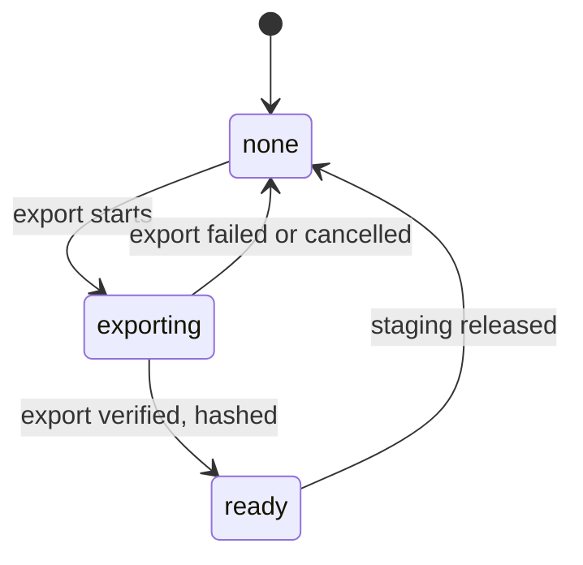

# System architecture

Last updated: 2026-11-09. Describes the code in this repository as built for PhotoVault 1.0.
Spec: [photovault-spec-v1.md](../requirements/photovault-spec-v1.md). Decisions: [decisions/README.md](../decisions/README.md). Module and file inventory: [codebase-summary.md](./codebase-summary.md).

PhotoVault is a sandboxed macOS menu-bar app (Swift 6, SwiftUI, GRDB) that copies the Photos library to one Google Drive root and to 0..n local or NAS folders. The app never deletes backup data at any destination.

## Contents

- [Module graph](#module-graph)
- [Runtime pipeline](#runtime-pipeline)
- [Sync cycle](#sync-cycle)
- [Job state machine](#job-state-machine)
- [Crash safety](#crash-safety)
- [Destinations contract](#destinations-contract)
- [Data stored](#data-stored)
- [Privacy boundaries](#privacy-boundaries)
- [Composition root and container](#composition-root-and-container)
- [Logging and redaction](#logging-and-redaction)
- [Deviations from the spec](#deviations-from-the-spec)

## Module graph

Edges are the dependencies declared in [Package.swift](../../Package.swift). The engine sees the Photos source and the destinations only through protocols in `PhotoVaultCore`. The app target injects the concrete Photos source and destinations. Test targets depend on their module plus `PhotoVaultTestSupport`; `PhotoVaultEngineTests` also depends on `PhotoVaultStore` and `PhotoVaultLocal`.

### Responsibilities

| Module | Responsibility | Key types |
|---|---|---|
| `PhotoVaultCore` | Models, persisted entities, protocols (`Destination`, `PhotosSource`, `ContentSource`, `FolderImportSource`, `ReverseGeocoding`, `Clock`, `LogSink`), error classes, job state machine, eligibility, naming, layout, classification, sidecar builders, policies (backoff, token bucket, disk guard, place naming, view diff). No I/O. | `JobTransitions`, `Eligibility`, `CategoryClassifier`, `NameSanitizer`, `SidecarBuilder`, `TokenBucket`, `DiskGuardPolicy` |
| `PhotoVaultStore` | GRDB `DatabasePool` in WAL mode, migrations `v1` to `v5`, repositories as stateless functions over `Database`, rolling `VACUUM INTO` backups. | `Store`, `Schema`, `JobRepository`, `DatabaseBackup` |
| `PhotoVaultPhotos` | PhotoKit adapter (a request that delivers no data for 15 minutes is abandoned), streaming export (the writer with inline MD5 and SHA-256 lives in Core), header-only camera classification, ImageIO and AVFoundation metadata, `CLGeocoder` adapter. | `PhotoKitSource`, `HeaderClassifier`, `ImageIOMetadataReader`, `CLGeocoderReverseGeocoder` |
| `PhotoVaultDrive` | OAuth 2.0 PKCE with a loopback redirect, refresh token in the Keychain, Drive v3 REST client, resumable upload, `GoogleDriveDestination`. | `GoogleAuthSession`, `OAuthClient`, `DriveAPI`, `ResumableUploader`, `GoogleDriveDestination` |
| `PhotoVaultLocal` | `LocalFolderDestination`: fd-relative writes, atomic no-overwrite placement, per-folder locks, `destination.json` marker. `LocalFolderSource`: a folder picked for a one-time import, read through a read-only bookmark (listing, hashing, copy), never written to. | `LocalFolderDestination`, `LocalFolderSource`, `AtomicFileWriter`, `FolderLockManager`, `DestinationMarker` |
| `PhotoVaultEngine` | `SyncCoordinator` runs the sync cycle; `SourceRegistry` maps `asset.source_id` to the adapter that reads its bytes (`ContentSource`: Photos, or a folder import); `ImportStage` runs folder imports (list, read and hash, dedupe, ingest) inside the cycle; change tracking, scan, classify, export, staging, upload fan-out, edit gate, sidecars, views, moves, place naming, startup and destination recovery, integrity checks, instance lock. | `SyncCoordinator`, `EngineEnvironment`, `ExportWorker`, `UploadRunner`, `StartupRecovery` |
| `PhotoVaultAppSupport` | Presentation logic without AppKit or SwiftUI: status and progress text (Vietnamese), notification policy, onboarding steps, settings form, rotating file log, `LogRedactor`, `TriggerDebouncer`. | `NotificationPolicy`, `LogRedactor`, `RotatingFileLog`, `StatusText` |
| `PhotoVaultTestSupport` | Fakes shared by test targets: fake Photos source, fake destination, destination conformance suite. | `FakePhotosSource`, `FakeDestination`, `DestinationConformanceSuite` |
| PhotoVault app target | `AppEnvironment` (composition root), `AppModel` and extensions, menu bar, onboarding, settings, activity window, login item, notifications, scheduler and system monitors. The app target has no unit tests. | `AppEnvironment`, `AppModel`, `SyncScheduler` |

## Runtime pipeline

## Sync cycle

`SyncCoordinator.run(trigger:)` is single-flight: a trigger that arrives during a cycle sets one follow-up flag, and the cycle runs once more. `SyncCoordinator.cycle(_:)` implements [spec 8.4](../requirements/photovault-spec-v1.md). Steps 3 to 9 repeat while a round makes progress (at most `maxCycleIterations`, default 100 000). Steps 10 and 11 run once at the end.

| Spec 8.4 step | Code | Notes |
|---|---|---|
| 1. Checks | `cycle` section "1. checks": Photos authorization, baseline taken, settings and `SystemMonitor` snapshot (network, expensive or constrained network, AC power), `DestinationHealth.refresh()`, `StartupRecovery.resolveInterrupted()`, `DeferredJobSweeper.sweep()`, `detectDataAtDestinations()`, stage `.checks` | `uploadsAllowed` gates step 6 only. Thermal state and Low Power Mode gate rate-limited export in `ResourceGuard`. |
| 2. ChangeTracker | `Scanner.run()` (FR-10, resumable), then `ChangeTracker.process()` (FR-12). Token expiry or unavailable details go to `Reconciler.reconcile` (FR-13). Then `FinalizePass.runAfterScan()`, `RecoveryService.runPending()` when a destination needs recovery (FR-51), and stage `.changes` | Each change commits with its own token in one database-only transaction. A scan that is not complete stops incremental processing. |
| 3. Classify | `ClassifyWorker.runPass()`, stage `.classify` (includes `ImportStage`) | Header-only read of provisional photos. Placement is fixed once the category is final. `ImportStage` lists a picked folder, reads and hashes up to `importBatchGroups` file groups per run outside transactions, and ingests each group in one transaction (dedupe by key, resource SHA-256 or capture second + stem + size; final category; placement; jobs). It sets `scanning` to `importing` when nothing is pending, and `importing` to `completed` (with one activity row) when no upload of the job is pending or running. A folder that cannot be read puts only its own job `offline`. |
| 4. Export | `ResourceGuard.enforce()` at the start of each round, then `ExportWorker.runPass()`, stage `.export` | Reads bytes from `env.sources.content(for: asset.sourceId)`. Assets of an `offline` or `cancelled` source are not candidates. Order: incremental, then refresh, reupload, backfill; primary resource first. At most `maxConcurrentExports` (2). Output is hashed while streamed. |
| 5. Edit gate | `EditGateStage`, step `.editGate` (FR-46) | Runs in `OrganizationServices.stages`. |
| 6. Fan-out | `UploadRunner.runPass()` through `FolderEnsurer` and `UploadAttempt`. Step `.fanOut` has no built-in stage. | At most 2 concurrent uploads per destination. Runs only when `uploadsAllowed`. |
| 7. Sidecars and views | `SidecarStage`, `ViewStage`, `DescriptionStage`, step `.sidecarsAndViews` | Sidecar jobs are created by `SidecarPlanner` inside the eligibility transactions. A Drive shortcut is created when its target job is `done`. |
| 8. MoveWorker | `MoveStage`, step `.moves`, wraps `MoveWorker.runPass()` | Folder renames (place names, device groups) and moves after a root or group change. |
| 9. PlaceNamer | `PlaceNamerStage`, step `.placeNamer`, `PlaceNamer` and `GeocodeScheduler` | At most 20 geocoder requests per minute. |
| 10. FR-53 and checks | `CloudIdBackfillStage`, `RecoveryVerifyStage`, `IntegrityStage`, step `.cloudIds` | Cloud-ID backfill in batches of at most 500. Integrity check every `integrityCheckIntervalDays` days (Settings, default 7). |
| 11. UI | `recordSuccess()`, then `publish()`: `SnapshotBuilder` builds an `EngineSnapshot`, delivered by `snapshots()` as an `AsyncStream` | `last_successful_sync_at` is set when the cycle uploaded something, or when no job was pending or uploading at an active destination. A cycle that could not upload what was waiting does not count. The app observes snapshots and, while the overall state is `syncing`, also re-reads the snapshot every 10 seconds. |

Staging is released after each round (`releaseUnneeded`, `expireIdle`), so uploads free space for more exports within the same cycle.

## Job state machine

`JobTransitions.apply` is the only code that changes an `upload_job` state (spec 8.3). Each job row is unique per destination, asset and resource type. The diagram shows state changes only. Bookkeeping events (`reserved`, `sessionStarted`, and `contentChanged` on a job that is not `done`) update fields without changing state.

Constants (`JobTransitions`): `maxAttempts` 8, `maxChecksumMismatches` 3, `deferredRetryInterval` 24 hours, `deferralLimit` 30 days.

A job is ready to upload when it is `pending`, due, and its resource is `ready` with `stagingGen >= targetGen`. Sidecar jobs have no resource and are ready when due.

Resource staging state (`resource.staging_state`, `StagingState`):

## Crash safety

The rule is "write the database before the side effect". Each step below is persisted before the next step runs. Fault-injection points (`EngineEnvironment.reach`) exist for tests; the app passes no fault injector.

| Mechanism | Where | Tests that exercise it |
|---|---|---|
| File ID reserved and persisted before create | `UploadAttempt.transfer`: `reserveIds` → `apply(.reserved)` → `apply(.startUpload)` → upload | `CrashRecoveryTests.crashAtEveryUploadStep`, `destinationCrashesAfterTheCreateEffect` |
| Upload generation | `startUpload` stores `uploading_gen`. `uploadSucceeded` sets `done_gen = uploading_gen`. A newer `target_gen` sends the job back to `pending` as a refresh. See [decision 0011](../decisions/0011-upload-generation-tracking.md). | `JobTransitionsTests.editDuringUploadIsNeverLost`, `EditGateTests.t30bAnEditRaisedWhileTheJobIsUploadingIsNotLost` |
| Folder ID reserved and persisted before `ensureFolder` | `FolderEnsurer`: `remote_folder` row saved with the reserved ID, `created = false` | `CrashRecoveryTests.crashBeforeRecoveryOfAFolderKeepsTheReservedFolderId`, `recoveryConfirmsAFolderCreatedJustBeforeTheCrash` |
| Shortcut ID reserved and persisted before create | `ViewExecutor`: `shortcut` row saved as `pending` with the reserved ID, then the create call | `OrganizationCrashTests.crashRightAfterTheShortcutWasCreatedDoesNotCreateItTwice` |
| Startup recovery | `StartupRecovery.run()`: `exporting` resources reset to `none`, orphan staging files removed, `uploading` jobs probed by remote ID (completed, requeued, or left for later when the destination is unreachable), unconfirmed folders confirmed, then participants (`MoveRecovery`) | `CrashRecoveryTests.recoveryResetsExportingAndRemovesOrphans`, `uploadFinishedButNotCommittedIsCompletedByRecoveryWithoutUploadingAgain` |
| Move jobs | `move_job` pending → inProgress → done, failed after 8 errors. `MoveRecovery` resumes them. | `OrganizationCrashTests.crashWhileMovingAFileIntoThePromotedDayFolder`, `crashWhileRenamingTheDayFolder` |
| Local atomic write | `AtomicFileWriter` writes `.photovault/tmp/<UUID>.part`, syncs and reads back, then places it without overwrite. Orphan sweep removes only names matching the `.part` pattern. | `LocalWriteTests.atomicWriteLeavesNoTempFiles`, `LocalRecoveryTests.crashingAtEveryStepLeavesNoPartFileNoDuplicateAndNoSplitFolder` |
| Single engine per container | `InstanceLock` takes an exclusive, non-blocking `flock` on `photovault.lock`. The kernel releases it when the process dies. | `InstanceLockTests.t41SecondInstanceIsRefused`, `lockIsReleasedWhenTheHolderGoesAway` |
| Database backups | `DatabaseBackup`: `VACUUM INTO` every 24 hours and before a migration, newest 7 kept | `DatabaseBackupTests.keepsSevenNewest`, `backsUpBeforePendingMigration` |
| Corrupt database at launch | `DatabaseBackup.restoreNewest` (called from `AppEnvironment`, FR-52): the newest backup that passes `PRAGMA integrity_check` replaces the file, and every destination is marked `recovery_required`. The damaged database, `-wal` and `-shm` files are moved aside as `<name>.corrupt-<time>`. Only SQLite corruption or not-a-database errors trigger it. | `DatabaseBackupTests.restoreNewestMarksEveryDestinationRecoveryRequired`, `theCorruptFileIsKeptAsideNotDeleted`, `onlyDamagedFilesCountAsCorruption` |
| Planned path before a local write | Destinations without reserved IDs: an `upload_intent` row (planned relative path + content SHA-256) is written in the same transaction as `startUpload` and deleted on completion; `StartupRecovery` probes and hashes that exact path | `PathAddressedCrashTests.aDayPromotedBetweenTheCrashAndTheRetryDoesNotLeaveACopyBehind`, `anEditedFileWrittenBeforeTheCrashIsReplacedByTheNewerEditNotSkipped` |
| Owner commands vs. the cycle | `ExclusiveLane`: owner commands (integrity check, recovery, root changes, retries, resort, view rebuild, reconciliation…) wait for the cycle's next pass boundary; the cycle re-checks pause, network, power and destination status at every boundary and before every upload | `ExclusiveLaneTests`, `IntegrityRobustnessTests` |
| Database durability (power loss included) | `DatabasePool`, WAL journal, `PRAGMA synchronous = FULL`, `fullfsync = ON`, `checkpoint_fullfsync = ON` on every connection | `DurabilityTests.everyConnectionIsFullySynchronous`, `SchemaAndAssetTests.fileDatabaseUsesWal` |

Lost database: `RecoveryService` rebuilds state from the destination. It runs only after a complete scan. It matches remote files to assets (`RecoveryMatcher`, three ways), and nothing uploads while the destination is recovering (`RecoveryTests`, `LocalRecoveryTests`).

## Destinations contract

`Destination` (in [Destination.swift](../../Sources/PhotoVaultCore/Protocols/Destination.swift)) is the only way the engine writes to a backup target.

| Member | Purpose |
|---|---|
| `checkAvailability()` | Status of the destination now (credentials, reachability, root) |
| `reserveIds(count:kind:)` | Reserve remote IDs (`files` or `shortcuts`). Used only when `capabilities.reservesIds` is true. |
| `ensureFolder(_:)` | Create or confirm a folder by logical path |
| `upload(_:onSession:)` | Upload content. `onSession` persists the resumable session before the first byte. |
| `resumeUpload(_:session:…)` | Continue an interrupted session |
| `probe(remoteId:)` | Look up one item (nil when missing) |
| `replaceContent(remoteId:_:)` | Replace the content of an existing file in place (refresh and checksum repair) |
| `move(remoteId:name:from:to:)`, `renameFolder(_:newName:)` | Moves and renames |
| `list(under:)` | Stream remote items for recovery and integrity. Drive also streams trashed items, with `trashed` set. |
| `quota()` | Storage quota when available |

Extensions:

- `ViewDestination`: `createShortcut`, `moveShortcut`, `trashShortcut`. Only shortcuts can be trashed. Implemented by Drive.
- `RootManaging`: `findRoots`, `checkRoot`, `createRoot`, `renameRoot`, `untrash`, `updateMetadata`. Implemented by Drive.

Capabilities (`DestinationCapabilities`):

| Capability | Google Drive | Local or NAS |
|---|---|---|
| `supportsViews` | yes | no |
| `supportsAppProperties` | yes | no |
| `supportsQuota` | yes | yes |
| `supportsDescription` | yes | no |
| `reservesIds` | yes | no (path-addressed, idempotent) |
| `verifiedHash` | MD5 | SHA-256 |

Errors: every destination throws `DestinationError` only. `ErrorClassifier` maps it to the spec 8.14 classes.

No delete operation exists. The protocols contain no delete method. The only removals are:

- Drive `trashShortcut`, which applies to shortcuts only.
- The local destination removes only its own `.part` files and the `.photovault-test` connection file (`DirectoryHandle` refuses every other name).

Both destination implementations pass `DestinationConformanceSuite` in `PhotoVaultTestSupport`.

## Data stored

### Database (`photovault.sqlite`)

Schema: migrations `v1`, `v2-upload-intent`, `v3-snapshot-counters`, `v4-provisional-index` and `v5-sources` in [Schema.swift](../../Sources/PhotoVaultStore/Schema.swift). The v5 DDL (`asset.source_id`, `source`, `import_item`, the `resource(sha256)` index) is in [Schema+Sources.swift](../../Sources/PhotoVaultStore/Schema+Sources.swift). The v3 and v4 DDL is in [SchemaSnapshotCounters.swift](../../Sources/PhotoVaultStore/SchemaSnapshotCounters.swift). The v3 triggers on `upload_job` keep the snapshot counters (`job_count`, `backfill_asset`, `job_bytes`, `snapshot_counter`) current, so a status read touches a few small rows. A shipped migration is final; later changes are new migrations. Columns differ slightly from spec 8.2. The migration is the source of truth. Extra columns include `asset.asset_key_hash`, `asset.creation_day`, `resource.next_export_attempt_at`, `resource.too_large_for_disk`, `upload_job.uploading_gen`, and `remote_folder.created`.

| Table | Holds |
|---|---|
| `destination` | One row per destination: kind, status and reason, scope, baseline time, rules and config JSON, account ID and e-mail, recovery flag |
| `asset` | One row per asset, keyed by `asset_key` (`c:<cloudId>` or `l:<localId>` for Photos, `x:<sha256>` for a file imported from a folder) with `source_id` saying where it came from: dates, media type, category and reason, placement (`placement_category`, `placement_day`, `name_stem`), flags, location and `geo_cell`, camera model, edit state, lifecycle timestamps |
| `source` | One row per one-time import (and, later, continuous source): kind, mode, display name, config JSON (read-only bookmark), status (`scanning`, `importing`, `offline`, `completed`, `cancelled`), listing and finish times |
| `import_item` | One row per file found in an import: group key, state (`pending`, `imported`, `duplicate`, `unsupported`, `failed`, `cancelled`), asset key, primary flag, date source |
| `asset_alias` | Alternative keys mapped to `asset_key` (re-attachment) |
| `name_alloc` | Name collision allocation per placement category, day and normalized stem |
| `album_member` | Album membership of each asset |
| `resource` | One row per asset and resource type: kind, RAW flag, filename, UTI, size, `content_gen`, MD5, SHA-256, staging generation, path and state, export counters, last error |
| `upload_job` | One row per destination, asset and resource type: kind, origin, state and reason, remote parent, name and ID, session reference, uploaded hash, `target_gen`, `done_gen`, `uploading_gen`, attempt and mismatch counters, retry times |
| `upload_intent` | Planned path and content hash of a local/NAS write in progress (crash recovery) |
| `day_stat` | Count, promotion flag (set at the day's first camera asset; it enables place naming), and place name state of each `camera` day |
| `geo_cache` | Reverse-geocode results per cell, under `en` and under `local` (the cell's second locale, `PlaceNameRule`), kept without expiry |
| `remote_folder` | Logical folder path to remote ID and display name, per destination |
| `move_job` | Pending moves and renames (`moveFile`, `renameFolder`) |
| `device_group`, `device_model` | "By device" grouping of camera make and model |
| `view_folder_group` | Folder groups for views |
| `shortcut` | Drive shortcut per destination, view and asset, with its state |
| `activity` | Newest 500 owner-visible events. Session references never reach this table. |
| `kv` | Change token, baseline token, scan state and cursor, archive timezone, schema version, last successful sync time (`last_successful_sync_at`), Mac disk-full timestamp (`mac_disk_full_since`, written by `ResourceGuard` at the first pass below the critical watermark and cleared once the disk is above it) |

### Files outside the database

| Path (container root) | Holds |
|---|---|
| `photovault.sqlite` | Database |
| `Staging/<first 32 hex of SHA-256(asset key)>/<resType>.<generation>` | Exported originals awaiting upload; sidecars use `<resType>.<destination>.<generation>` |
| `Backups/` | `VACUUM INTO` copies, newest 7 |
| `Logs/photovault.log` and rotated files | File log, at most 5 files |
| `photovault.lock` | Instance lock |
| `notification-ledger.json` | Notification throttle state (12-hour windows) |
| `drive-daily-cap.json` | Drive 24-hour upload byte accounting (FR-49), restored at launch |
| Destination folder: `.photovault/destination.json` | Marker that identifies the owning destination |
| Destination folder: `.photovault/tmp/` | In-flight `.part` files |

### Keychain

One item holds the Google refresh token: service `com.annh.photovault.google`, data-protection keychain, `kSecAttrAccessibleAfterFirstUnlockThisDeviceOnly`, not synchronizable ([decision 0010](../decisions/0010-keychain-class.md)). Sign-out deletes the Keychain item first, even if revocation fails (`AuthSessionTests.signOutDeletesKeychainFirstEvenWhenRevokeFails`).

## Privacy boundaries

What leaves the Mac:

| Recipient | Data sent | Not sent |
|---|---|---|
| Google OAuth (`accounts.google.com`, `oauth2.googleapis.com`) | Authorization code exchange and token refresh, scopes `drive.file openid email`. Loopback redirect to `127.0.0.1` stays on the Mac. | Photos content |
| Google Drive API (`www.googleapis.com`) | Media bytes, sidecars, descriptions, folder and file names (names carry the original camera name, for example `2026-11-08 23.30.00_IMG_4821.HEIC`), place names in folder names, `appProperties` keys `pvAssetId`, `pvResType`, `pvKind`, `pvCategory`, `pvSchema`, `pvLogical`, `pvView`, `pvRoot`, `pvArchiveTZ`. Asset IDs longer than the 124-byte property limit are sent as a hash (`h:` plus 32 hex characters). | Local paths, bookmarks, tokens in logs |
| Apple geocoder through `CLGeocoder` | The centre of a 0.01° grid cell (`GeoCell.center`) and the display locale ([decision 0008](../decisions/0008-geocoding-privacy.md)) | Exact coordinates, asset identifiers, hidden or deleted assets |
| Local and NAS folders | Media bytes, sidecars, the destination marker | Anything outside the folder the owner chose; access is through a security-scoped bookmark |
| Apple iCloud through PhotoKit | Requests for originals with `isNetworkAccessAllowed = true`. This is inbound traffic for iCloud-only originals. | Nothing is uploaded to iCloud by the app |
| Notifications | Vietnamese texts without file names, album titles or paths | |

Other facts:

- The only third-party package is GRDB ([Package.swift](../../Package.swift)). There is no analytics or telemetry SDK.
- Backups at destinations are not encrypted by the app (no client-side encryption). Drive and NAS owners control access to their own storage.
- The app stores no secret in the repository. The Google client ID and client secret are read at launch from the bundle's `PVGoogleClientID` and `PVGoogleClientSecret` keys, which build settings fill from the gitignored `Config/Secrets.xcconfig` (see [Config/Secrets.xcconfig.example](../../Config/Secrets.xcconfig.example)).

## Composition root and container

`AppEnvironment.make()` in [AppEnvironment.swift](../../PhotoVault/Engine/AppEnvironment.swift) builds everything once at launch:

1. `ContainerLocator.resolve`. A sandboxed build (environment variable `APP_SANDBOX_CONTAINER_ID` set) uses `Application Support/PhotoVault` inside the container. An unsandboxed build is refused unless started with `--dev-container`, which uses `~/Library/Application Support/PhotoVault-dev` ([decision 0009](../decisions/0009-sandbox-container.md)).
2. `InstanceLock.acquire`. A second instance on the same container exits with "already running".
3. `Store.open` and `SettingsStore`. On failure the app shows an alert; the log has the details.
4. Google configuration from the bundle. `LoggingHTTPTransport` wraps `URLSessionTransport`. `OAuthClient` and `GoogleAuthSession` (Keychain) are created.
5. `DestinationRepository.fetchAll`. Creates `GoogleDriveDestination` when a Drive row exists, and one `LocalFolderDestination` per local row with a valid bookmark. The `DestinationRegistry` holds them.
6. `EngineEnvironment` with the Photos source (`PhotoKitSource`), `ImageIOMetadataReader`, `UTTypeResolver`, `VolumeDiskSpaceProvider`, `SystemMonitor`, `CLGeocoderReverseGeocoder`, and `LocalContentReader`. Then `SyncCoordinator(env:)`.

`AppEnvironment` is passed to `AppModel`, which owns the scheduler, the Photos change observer (debounced by `TriggerDebouncer`), the power and workspace monitors, and the UI state. `SyncScheduler` runs the 60-minute background activity, a 5-minute re-check of unavailable local folders, and a 15-minute re-check while the Mac disk state is not OK.

## Logging and redaction

- `AppLogSink` sends each message to `os.Logger` (subsystem and category) and to `RotatingFileLog`.
- `LogRedactor.sanitized` runs first. A message that matches a token, session URL, path, file name, coordinate pair, or e-mail pattern is replaced by `[message withheld: contains <reason>]`.
- Callers log asset keys and job IDs, not file names or coordinates (`LoggingTests`, `RedactionTests.noSecretReachesTheLogs`, `CoordinatorTests.logsCarryJobIdsButNeverFileNamesOrCoordinates`).
- The unified log entries are marked public after redaction, so `LogRedactor` is the only protection on that path.
- `RotatingFileLog` writes `photovault.log` and rotates to `photovault.1.log` through `photovault.4.log`.
- The owner-visible activity list (`activity` table, `ActivityLog`) keeps the newest 500 events and never stores session references (`sessionRefRoundTripsButNeverReachesActivity`).

## Deviations from the spec

| Topic | Spec | Code | Record |
|---|---|---|---|
| Unsandboxed run | Silent | Refused without `--dev-container` | [0009](../decisions/0009-sandbox-container.md) |
| Keychain class | Silent | Data-protection keychain, this device only | [0010](../decisions/0010-keychain-class.md) |
| `done_gen` | `done_gen = target_gen` | `done_gen = uploading_gen`, refresh when target is higher | [0011](../decisions/0011-upload-generation-tracking.md) |
| Geocoder input | Silent on hidden assets | Cell centres only; hidden (when hidden upload is off) and deleted assets excluded | [0008](../decisions/0008-geocoding-privacy.md) |
| macOS 27 metadata | `caption` and `keywords` where available | Not compiled against the current SDK; sidecars write `"extendedMetadata":"unavailable"` | [0006](../decisions/0006-macos-27-apis-unavailable.md) |
| Backfill rate and watermarks | GB | Constants are GiB (`GlobalSettings.GiB`) | [0015](../decisions/0015-disk-guard-watermarks.md) |
| Drive daily cap | 700 GB | 700 × 10⁹ bytes | [0016](../decisions/0016-daily-upload-cap-700gb.md) |
| Upload state | `upload_job` columns | Adds `uploading_gen` | [0011](../decisions/0011-upload-generation-tracking.md) |

Spec items still marked [VERIFY] run on the spec default in code. Their owner procedures are in [spikes/README.md](../spikes/README.md), and the test status is in [test-report.md](../test-report.md).
